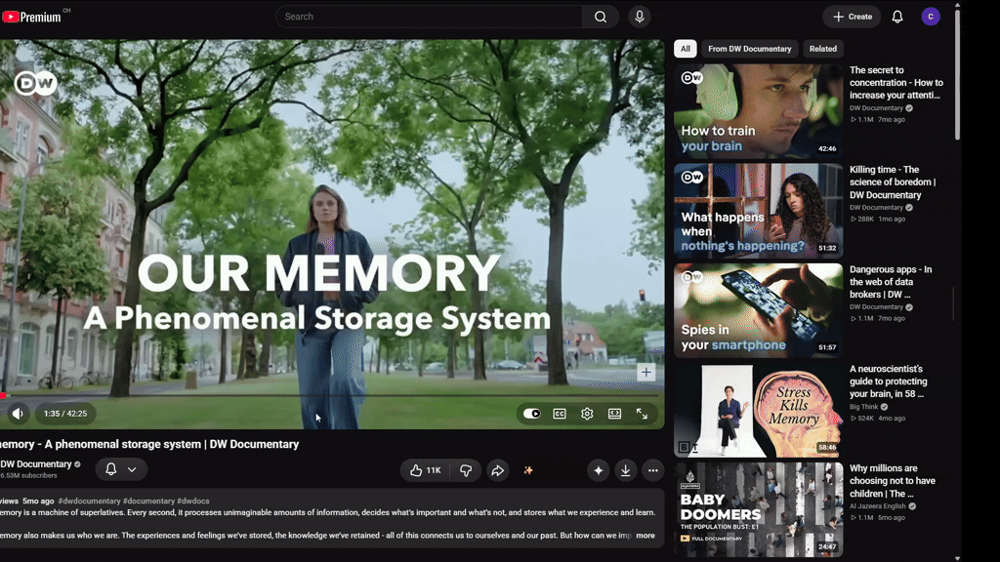

# Vidigest YouTube Summarizer

A Chrome/Brave extension that summarizes YouTube videos with your choice of LLM: **Claude, GPT, Gemini, or local Ollama**. Long videos are split into parts and summarized page by page, every key point links to its moment in the video, and finished summaries are saved so you can reopen them without calling the AI again. No backend, no data collection. Your API key stays in your browser.

[](https://github.com/ebcodev/vidigest-youtube-summarizer/actions/workflows/ci.yml)
[](LICENSE)
[](https://developer.chrome.com/docs/extensions/mv3/intro/)
[](#providers)

> The demo is from an earlier UI. The panel now also has a pager for multi-part summaries and a minimize button.



## Features

- **Bring your own model**: Anthropic Claude, OpenAI GPT, Google Gemini, or Ollama (local). Switch anytime in Settings.
- **Works with YouTube's current caption protection.** Captions are read through YouTube's own player (which signs the requests), with DOM-scrape, innertube and legacy fallbacks.
- **Long videos are summarized in parts.** Transcripts over the configurable size limit are split; each request is told "part 2 of 3", receives the earlier parts' summaries, and whole-video sections (Takeaways) are written only in the final part. Custom prompts get the same part context.
- **Paginated panel**: ‹ › buttons and clickable part dots; read finished parts while later ones are still generating.
- **Jump links**: the transcript keeps caption timestamps, so every key point ends with a `[m:ss]` link that seeks the video.
- **Saved summaries**: finished summaries are saved per video for 30 days. Clicking **Summarize** again, or **Open summary** in the toolbar popup, reopens the saved one; `↻` regenerates.
- **Minimize** the panel and keep a summary generating in the background; reopen it from the button or the toolbar icon.
- **Summary in the video's language** with the default prompt.
- **Rate-limit aware**: HTTP 429/529/503 responses are retried after the provider's `retry-after`, with a countdown in the panel.
- **Multi-modal** (optional): chapter thumbnails or the main thumbnail are sent to vision-capable models; each part only gets the thumbnails in its time range.
- **Nested lists, numbered lists, headings, bold/italic, code** rendered safely (escape-first renderer).
- **Customizable system prompt**.
- **Zero backend**: requests go straight from your browser to the provider.

## Install

### From source

```bash
git clone https://github.com/ebcodev/vidigest-youtube-summarizer.git
```

1. Open `chrome://extensions` (or `brave://extensions`) and enable **Developer mode**.
2. Click **Load unpacked** and select the `extension/` folder.
3. Click the extension icon in the toolbar, then **Settings**.
4. Pick a provider, paste your API key (or configure Ollama), and save.

Requires Chrome/Brave 111 or newer (the extension uses a main-world content script).

## Usage

Open any YouTube watch page and click **✨ Summarize** in the action row.

Panel controls: `⎘` copy markdown (all parts) · `↻` regenerate · `–` minimize · `✕` close (also stops a summary that is still generating). For multi-part summaries, use `‹ ›` or the dots to change parts. Click any `[m:ss]` to jump to that moment.

Toolbar popup: on a video that already has a summary (saved, minimized or generating), the popup shows **Open summary**.

## Providers

Default models follow each provider's own "start here" recommendation as of November 2026. Any model name the provider supports can be typed in Settings.

| Provider | Get a key | Default model | Also listed |
|---|---|---|---|
| **Anthropic** (Claude) | [console.anthropic.com](https://console.anthropic.com/settings/keys) | `claude-opus-5-5` | `claude-sonnet-5-5`, `claude-haiku-5-5`, `claude-fable-5-2` |
| **OpenAI** (GPT) | [platform.openai.com](https://platform.openai.com/api-keys) | `gpt-6.2-astra` | `gpt-6.2-sol`, `gpt-6.1-terra`, `gpt-6-luna`, `gpt-5.4-mini` |
| **Google Gemini** | [aistudio.google.com/apikey](https://aistudio.google.com/apikey) | `gemini-3.8-flash` | `gemini-4-argon`, `gemini-3.6-flash`, `gemini-3.5-flash-lite` |
| **Ollama** (local) | — | `gemma4` | `qwen3.6`, `qwen3-vl`, `gpt-oss:20b`, `llama3.2` |

Current models think/reason before answering and those tokens count toward the output cap, so each request allows up to 16,000 output tokens. You are billed only for tokens actually generated.

### Ollama setup

Ollama blocks cross-origin requests by default. Allow **only this extension** (its ID is shown in Settings when you pick Ollama):

```bash
# macOS / Linux
export OLLAMA_ORIGINS='chrome-extension://<extension-id>'
ollama serve
```

Avoid `chrome-extension://*`: it lets every installed extension use your Ollama server.

## Long videos and the part size

Settings → **Max transcript characters per request** (default 80,000 ≈ 20–27k tokens). A transcript longer than that is split into balanced parts on line boundaries. Lower it if you hit "rate limit" or "too large" errors; raise it for fewer, longer parts. With large-context models most videos under ~1.5 hours fit in one request.

## How it works

### Transcript extraction

Methods tried in order, each producing timed lines like `[12:40] text…`:

1. **Player captions** (`extension/page-bridge.js`, main world): asks YouTube's player to load captions, captures the caption URL the player signed with its proof-of-origin token (`pot`), and re-fetches it as `json3`.
2. **DOM scrape**: opens YouTube's transcript panel and reads segments and timestamps.
3. **Innertube** `get_transcript`, sent from the page with YouTube's real `INNERTUBE_CONTEXT`.
4. **Legacy caption URLs** (`json3`, then XML). Usually empty now without a `pot`.

Transcripts are cached for 24 hours in `chrome.storage.local`.

### Summarization

`extension/background.js` splits the transcript (`splitTranscript` in `lib/parsers.js`), then summarizes parts one after another over a long-lived port, streaming `plan / part-start / chunk / status / part-done / done / error` messages to the panel.

### Storage

- `chrome.storage.sync`: `activeProvider`, `providers.{name}.{apiKey|baseUrl|model}`, `customPrompt`, `includeImages`, `maxChunkChars`.
- `chrome.storage.local`: `tr2:<videoId>` transcripts (24 h, max 50) and `sum:<videoId>` saved summaries (30 days, max 100).

## Privacy

- API keys are stored in `chrome.storage.sync`, synced with your browser profile.
- Transcripts, titles and (optionally) thumbnails go only to the provider you selected. The Gemini key is sent in a header, not the URL.
- Transcripts and summaries are stored locally on your device.
- No telemetry or analytics. See [PRIVACY.md](PRIVACY.md).

## Development

No build step. Edit files under `extension/`, reload the extension card, reload the YouTube tab.

```bash
for f in extension/lib/parsers.js extension/background.js extension/content.js extension/page-bridge.js extension/options.js extension/popup.js; do node --check "$f"; done
python3 -c "import json; json.load(open('extension/manifest.json'))"
node --test tests/*.test.js
```

## Credits

Written with [Claude Code](https://claude.com/claude-code) assistance (see `Co-Authored-By` trailers).

## License

Apache License 2.0. See [LICENSE](LICENSE) and [NOTICE](NOTICE).
